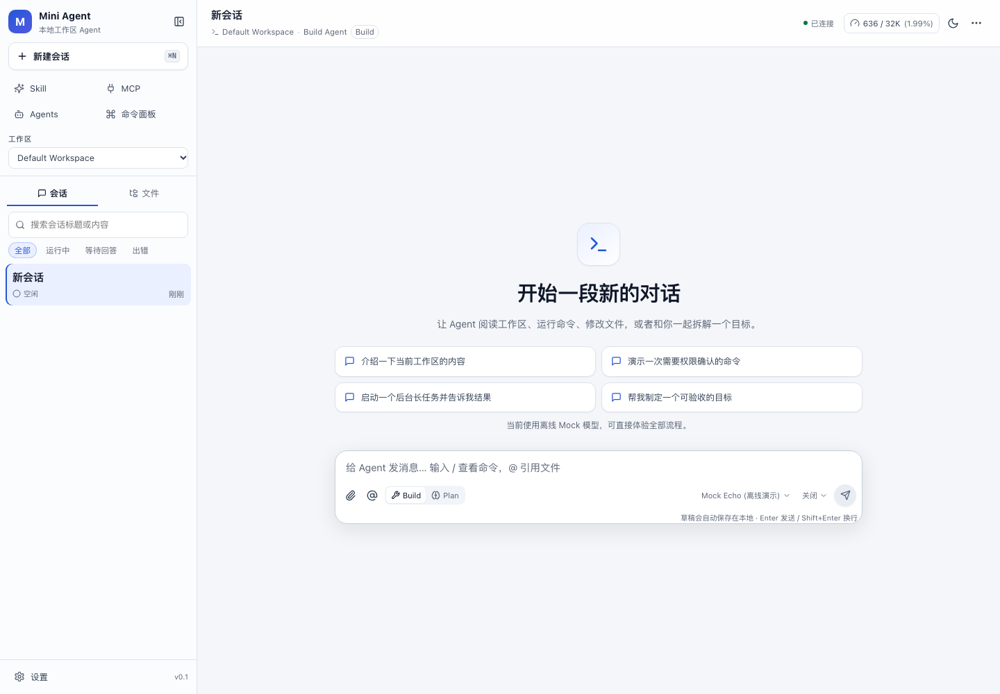
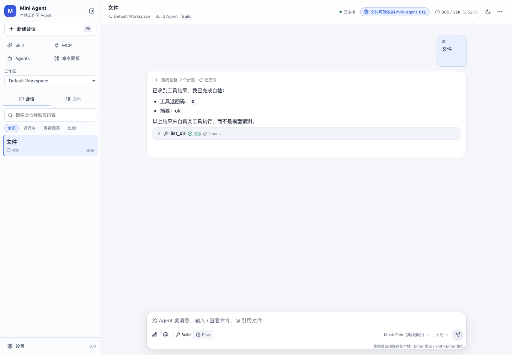
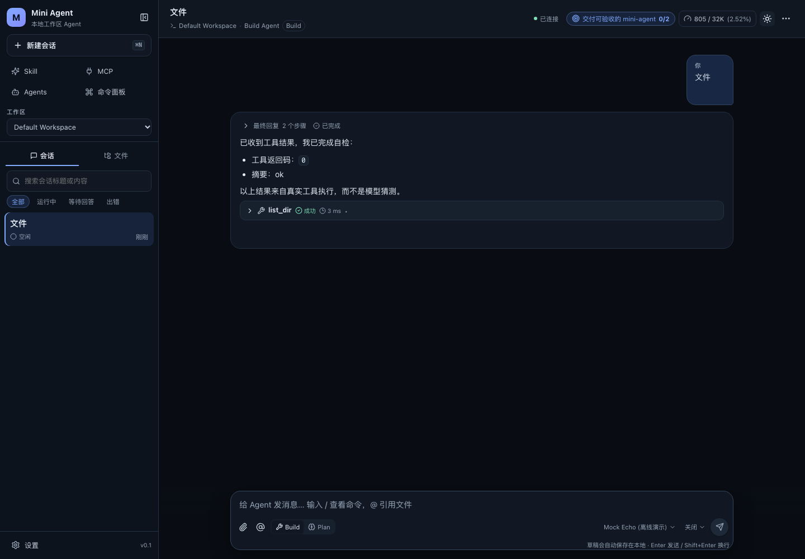
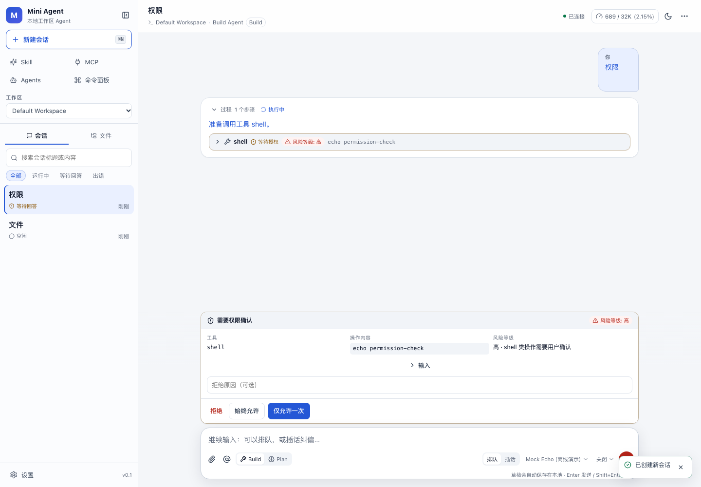
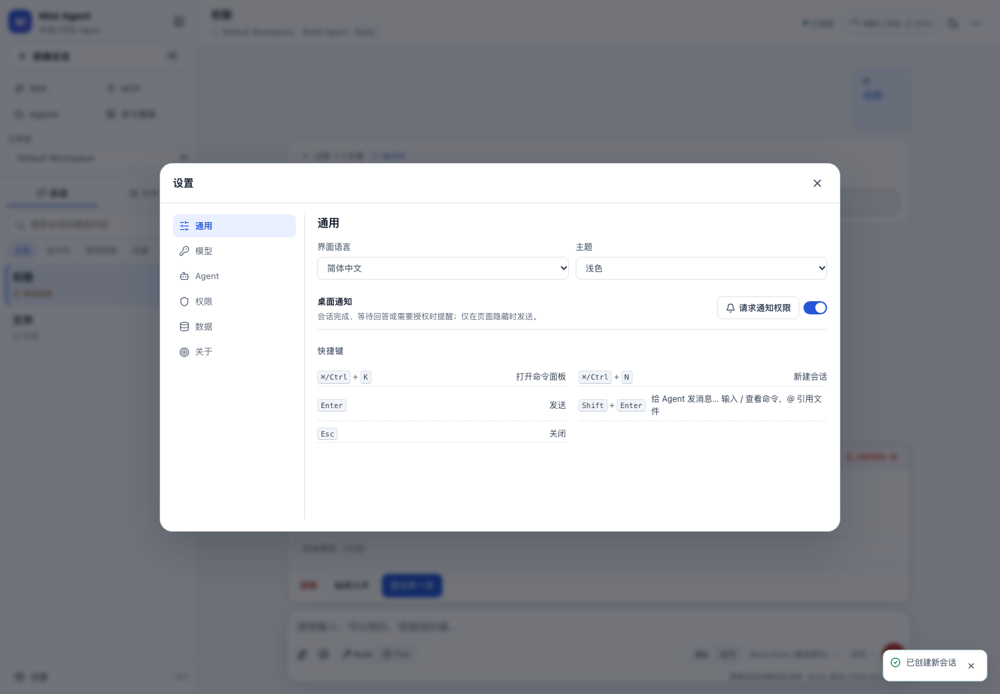
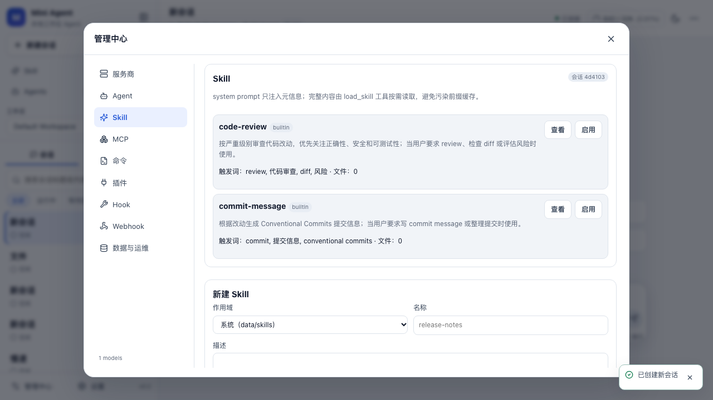

# Mini Agent

一个**可运行、可持久化、可验收**的最小 Agent 工作台：后端 Python / FastAPI，前端 React + Vite + Tailwind CSS v4 + shadcn/ui，SQLite 使用 WAL，REST 操作 + SSE 事件流。

本项目依据 [`create-common-agent-guide.md`](create-common-agent-guide.md) 的 P0 核心能力实现，并以该文件 **附录 D 验收清单** 作为硬性交付标准。验收清单的自动化证据见 [`docs/ACCEPTANCE.md`](docs/ACCEPTANCE.md)。



## 快速开始

环境要求：Python ≥ 3.11、[uv](https://docs.astral.sh/uv/)、Node.js ≥ 20、pnpm ≥ 10。

```bash
# 一键启动（会自动构建前端，后端同时托管 UI 和 API）
./scripts/start.sh
# 打开 http://127.0.0.1:8787
```

默认使用离线 **Mock 模型**，不需要 API Key，可以直接体验：流式输出、工具调用、权限确认、`ask_question`、长任务、队列、目标、压缩、分享、Skill、MCP、插件、自定义命令、附件与文件检查点。

开发模式（Vite HMR + 后端热重载）：

```bash
./scripts/dev.sh
# UI:  http://127.0.0.1:5173
# API: http://127.0.0.1:8787
```

Docker：

```bash
docker compose up --build
# 打开 http://127.0.0.1:8787，数据持久化在 ./data
```

## 接入真实模型（DeepSeek）

```bash
cp .env.example .env
# 编辑 .env：DEEPSEEK_API_KEY=sk-...
./scripts/start.sh
```

然后在「设置 → 模型」把默认模型切换为 `deepseek/deepseek-chat`，或在输入区为当前会话切换模型。API Key 只通过环境变量或 `data/secrets.yaml` 注入。

默认配置已包含 `deepseek-flash` 与 `deepseek-v4-pro`，推理级别为 `off, low, medium, high, max`。旧数据库或自定义模型可在「管理中心 → 服务商」点击模型 ID 编辑级别；`off` 会发送 `thinking: {type: disabled}`，其他级别会发送 `thinking: enabled` 与映射后的 `reasoning_effort`（DeepSeek 侧 `medium` 实际映射为 `high`，这是其官方映射）。

```yaml
# data/secrets.yaml  (chmod 600，禁止提交)
providers:
  deepseek: sk-...
```

配置优先级（低 → 高）：内置默认 → `config/mini-agent.yaml` → `data/workspace.yaml` → 环境变量 → 企业策略 `config/policy.yaml`（或 `MINI_AGENT_POLICY`）。策略覆盖 server/defaults/budget/permissions/network/search/tools/sandbox/retention/api/compaction/subagents/tasks/metrics/backup/webhooks/hooks；Provider 数据由管理中心/数据库管理，不受该文件覆盖。完整示例与 JSON Schema：

- [`config/mini-agent.example.yaml`](config/mini-agent.example.yaml)
- [`config/config.schema.json`](config/config.schema.json)（`cd backend && uv run python ../scripts/export_config_schema.py` 可重新生成）
- [`config/policy.example.yaml`](config/policy.example.yaml)（企业策略示例，最高优先级）

## 已实现能力

| 领域 | 能力 |
|---|---|
| 会话 | 多轮对话、持久化、标题、置顶、归档、搜索、Fork、消息编辑分支、导入 JSON、删除级联、子 Agent 关系 |
| 运行时 | 单会话单写者、Turn/Step 状态机、预算、死循环检测、暂停/恢复/取消、优雅停机、只读工具并行批处理 |
| 模型 | OpenAI Chat、OpenAI Responses、Anthropic Messages、离线 Mock；流式、重试/退避、`Retry-After`、备用模型链、结构化输出（Chat/Responses；Anthropic 显式不支持）、OAuth client-credentials、代理/自定义 CA、余额查询、模型拉取与能力推断 |
| 缓存 | `raw_json` 原样回放、固定工具排序、只追加前缀、`prefix_hash`、缓存命中记录、调试面板 |
| 工具 | 文件读写/编辑/多编辑、目录、glob、grep、shell、后台 shell、`ask_question`、`todo_write`、`wait`/`task_status`/`task_cancel`、`web_fetch`、`web_search`、`read_image`、`load_skill`、`spawn_agent` |
| 安全 | 严格 JSON Schema、权限 allow/ask/deny（含 mcp/plugin/subagent 分类）、路径/符号链接逃逸、SSRF、命令黑名单、子进程密钥隔离、可选 API Token + 限流、企业策略对配置节最高优先级 |
| 交互 | 四种问题题型、权限「一次/始终/拒绝」、持久化交互、刷新恢复、排队/插话、附件消息 |
| 任务 | `taskId`、后台命令、等待兜底、完成 system 通知并推动自检、重启后明确失败并通知 |
| 上下文 | 手动/自动压缩、确定性或独立模型摘要、压缩后重载 AGENTS.md/Skill/MCP 元信息、原始历史保留 |
| 事件 | 全局递增 ID、SSE `Last-Event-ID` 续传、快照 + 增量、流式内容与事件同事务 |
| 扩展 | 三层 Skill（内置/系统/工作区）、MCP stdio/HTTP/SSE、声明式插件（工具/Agent/命令/Hook/UI 元数据）、自定义命令参数与预览、生命周期 Hook、子 Agent 深度/并发限制 |
| 附件 | 图片压缩与视觉描述、PDF 文本提取、文本附件、OpenAI/Anthropic 多模态内容、消息附件展示 |
| 文件 | `.gitignore`/`.mini-agentignore` 过滤、读取哈希、外部修改冲突检测、写前检查点、统一 diff、Turn 级撤销/重做、自动格式化 |
| 运维 | 备份/恢复（重启生效）、保留策略、日志轮转/导出、Prometheus `/metrics`、Webhook HMAC 签名与重试、余额、策略/原始配置查看 |
| 前端 | 可折叠侧栏、移动端抽屉、Markdown + GFM + 高亮 + KaTeX + Mermaid、长对话虚拟列表、附件上传/预览、文件内容搜索、Diff、管理中心、中英文、主题、草稿、IME |
| 数据 | Alembic 迁移、WAL、导出 Markdown/JSON、只读分享、调试前缀、Python SDK |
| 质量 | **78 个后端测试、23 个前端单元测试、13 个 Playwright E2E**、Ruff/ESLint/tsc 门禁、对比度测试 |

> 明确排除：账号/多租户/RBAC/审计/配额（第 6 项）与高级分享隐藏/字段级脱敏（第 11 项）。其余扩展均已实现；边界见[当前范围与限制](#当前范围与限制)。

## 架构

```text
React + Vite UI
  │  REST 操作                 SSE / Last-Event-ID
  ▼                              ▼
FastAPI API ─────────────── Event Store (SQLite, 全局递增 id)
  │                              ▲
  ▼                              │
Session Runtime (单会话单写者) ──┘
  ├─ Model Gateway (Chat / Responses / Anthropic / Mock, fallback, usage)
  ├─ Tool Registry + Permission Evaluator + Path/SSRF/Sandbox Guard
  ├─ Skill / MCP / Plugin / Command / Hook Services
  ├─ Sub-agent Runtime (depth + concurrency + permission ceiling)
  ├─ Interaction Manager (ask_question / permission, 持久化 + Future)
  ├─ Task Manager (taskId, 后台 shell, 完成通知)
  ├─ Upload / Vision / Checkpoint / Diff
  └─ Compaction (LLM or deterministic summary + prompt reload)
        │
        ▼
SQLite (WAL) + Alembic + artifacts/uploads/checkpoints/backups/logs
```

关键设计：

- **事件驱动**：所有用户可见状态变化都写入 `event` 表并广播；前端先拉快照，再用 `Last-Event-ID` 续传。
- **单会话单写者**：每个会话一个 `asyncio.Lock`，后台任务与用户消息通过持久化队列解耦。
- **前缀缓存**：消息 `raw_json` 原样回放；工具定义按名称排序；流式内容与对应 delta 事件在同一事务提交，避免刷新后“缺一段/重复一段”。
- **权限默认安全**：读工具默认允许，写/命令/网络默认询问；Plan 模式强制只读；拒绝后用签名阻断相同参数的重复调用。
- **可恢复**：启动时把运行中的 Turn、工具、任务、交互标记为失败/取消，补齐 tool result，并追加可读的恢复通知；不会自动重放危险操作。

更完整的设计说明与权衡记录见 [`docs/ARCHITECTURE.md`](docs/ARCHITECTURE.md)。

## 目录结构

```text
backend/
  mini_agent/
    api.py            REST + SSE，统一错误/请求 ID
    runtime.py        Turn 状态机、工具编排、暂停/恢复、交互
    model_gateway.py  Chat/Responses/Anthropic/Mock、重试、用量、前缀序列化
    tools.py          工具 Schema 与受限执行
    security.py       权限、路径、SSRF、沙箱、脱敏
    skills.py / mcp.py / plugins.py / commands.py / hooks.py
    checkpoints.py    检查点、diff、撤销/重做
    uploads.py        图片/PDF/文本附件与视觉
    ops.py            备份、保留策略、日志、指标
    webhooks.py       签名 Webhook 与投递记录
    tasks.py          taskId 后台任务
    compaction.py     压缩摘要与模型消息重建
    recovery.py       重启恢复
    serialization.py  快照 DTO
    db.py / models.py / migrations/
  tests/              验收、网关、安全、配置测试
frontend/
  src/                React UI、SSE 状态折叠、单元测试
  src/components/ui/  shadcn/ui 基础组件（直角主题，可直接修改）
  e2e/                Playwright 端到端
config/               示例配置与 JSON Schema
docs/                 架构、验收证据、自检、截图
scripts/              start / dev / test / schema / e2e server
```

## 测试与质量门禁

```bash
./scripts/test.sh            # 后端 ruff+pytest，前端 tsc+eslint+vitest+build
RUN_E2E=1 ./scripts/test.sh  # 额外运行 Playwright
```

单独运行：

```bash
cd backend && uv run pytest -q
cd frontend && pnpm test && pnpm typecheck && pnpm lint && pnpm build
cd frontend && pnpm exec playwright test
```

验收清单逐项证据（含测试名、场景和结果）见 [`docs/ACCEPTANCE.md`](docs/ACCEPTANCE.md)。

## 管理中心与扩展

侧栏「管理中心」提供：服务商/模型、Agent、Skill、MCP、自定义命令、插件、Hook、Webhook、工作区、备份/恢复、日志/保留策略/策略查看。

- **Skill**：`skills/<name>/SKILL.md`（内置）、`data/skills`（系统）、`<workspace>/.mini-agent/skills`（工作区），支持渐进式 `load_skill`。
- **MCP**：stdio / Streamable HTTP / SSE；工具命名空间为 `mcp__<serverId>__<tool>`，按会话启用。
- **插件**：仅接受手动上传 zip，安装后默认不信任；信任并启用后可贡献工具、Agent、命令、Hook 和 UI 元数据。
- **命令**：支持 `$ARGUMENTS`、`$1..$9`，发送前可预览最终 Prompt。
- **Hook**：`session.start` / `turn.end` / `tool.before` / `tool.after` / `compaction.after`，独立子进程 + stdin JSON + 环境变量 + 超时。
- **子 Agent**：`spawn_agent`，默认前台等待、可后台运行；深度与并发受限，权限不超过父 Agent。
- **附件**：图片自动压缩并可调用视觉辅助模型；PDF 提取文本；兼容 Chat/Responses/Anthropic 多模态格式。

## 配置说明

- `config/mini-agent.example.yaml` 可直接复制为 `config/mini-agent.yaml`；支持 camelCase 与 snake_case。
- 用户设置页修改的常用配置写入 `data/workspace.yaml`，重启后仍生效。
- 配置解析失败会快速失败并给出文件路径，不会静默使用半份配置。
- API Key 支持 `${env:VAR}`、环境变量和 `data/secrets.yaml`；接口只返回“已配置/末尾 4 位”。
- 数据目录默认 `./data`，可通过 `MINI_AGENT_DATA_DIR` 修改；工作区默认 `<data>/workspaces/demo`。

## API 与事件

- OpenAPI：`/docs`、`/openapi.json`
- 健康检查：`/api/v1/healthz`、`/api/v1/readyz`
- SSE：`GET /api/v1/sessions/{id}/events`，请求头 `Last-Event-ID`
- 事件类型：`turn.*`、`content.delta`、`reasoning.delta`、`tool.*`、`task.updated`、`interaction.*`、`queue.updated`、`usage.updated`、`session.status`、`compaction.created`、`error`、`model.retry` 等
- 错误响应统一为 `{ code, message, data, timestamp, requestId }`
- 可选静态 Token：`MINI_AGENT_API_TOKEN`。`api.requireTokenRemote=true` 时必须同时配置 Token，否则启动失败；非回环请求需 `Authorization: Bearer <token>`，回环访问默认放行，便于本地 UI。前端远程部署可在构建时设置 `VITE_API_TOKEN`，或在「管理中心 → 数据与运维」把 Token 保存到当前浏览器 localStorage（REST 与 SSE 都会携带）；反向代理必须传递 `X-Forwarded-For`，否则本机代理会被视为回环。
- `/metrics` 受 `metrics.enabled` 控制，并与 `/docs`、`/openapi.json` 一起纳入 Token/限流中间件；公开分享路由 `GET /api/v1/shares/{token}` 单独放行。
- 限流：`api.rateLimitPerMinute`（默认 600，设为 0 可关闭）。

## 数据、备份与运维

- 数据库：`data/mini-agent.sqlite3`（WAL）；迁移 `backend/migrations/`，启动时自动升级。
- 大输出：`data/artifacts/`；附件：`data/uploads/`；检查点：`data/checkpoints/`；日志：`data/logs/`；备份：`data/backups/`。
- 管理中心可创建/下载/删除备份；恢复会先暂存，重启服务后应用（并保留 pre-restore 备份）。
- 保留策略可定期/手动清理事件、附件、artifacts、备份和日志；启动时自动执行一次。
- Prometheus：`GET /metrics`；日志导出：`GET /api/v1/system/logs/export`。
- 静态 API Token：`MINI_AGENT_API_TOKEN` + `api.requireTokenRemote`；远程请求需 `Authorization: Bearer <token>`，本机回环默认放行。不是账号体系。

## 安全说明

- 子进程使用受限环境变量，不继承 `DEEPSEEK_API_KEY` 等密钥。
- 工具输出、网页、文件内容都视为不可信数据；系统提示明确禁止绕过权限。
- `web_fetch` 禁止 localhost、内网、链路本地和云元数据地址，并对重定向逐跳校验。
- 文件工具拒绝 `..`、绝对路径逃逸和符号链接逃逸。
- 日志、导出、分享、错误响应统一脱敏。
- **无账号体系**：默认绑定 `127.0.0.1`；提供可选静态 API Token 与限流，但不提供账号/多租户/RBAC。公网部署仍需 HTTPS、反向代理和网络隔离。

## 当前范围与限制

- 明确排除（按需求）：账号/多租户/RBAC/审计/配额/合规（原第 6 项）与高级分享隐藏/字段级隐藏（原第 11 项）。
- 分享仅提供基础只读链接（可撤销/过期/隐藏工具 IO），不提供字段级脱敏。
- 插件 UI 扩展以声明式元数据和管理面板展示为主，不执行第三方 JS；这是有意的安全边界。
- MCP SSE 实现为按请求建立 SSE 通道的兼容模式；部分只支持长连接复用的事件流服务器可能需要适配。
- 未做真实 DeepSeek/Anthropic/OpenAI 联网验收（自动化使用 Mock/Scripted Gateway），也未做严格性能基准；真实调用受网络、余额和提供商限流影响。
- 未在本机验证 Docker 构建（环境无 Docker）；Dockerfile/Compose 保留。

## Python API SDK

```bash
pip install -e sdk/python
```

```python
from mini_agent_sdk import MiniAgentClient

with MiniAgentClient("http://127.0.0.1:8787") as client:
    session = client.create_session()
    client.send(session["id"], "你好")
    for event in client.stream_events(session["id"]):
        print(event["type"], event["data"])
```

见 [`sdk/python/mini_agent_client.py`](sdk/python/mini_agent_client.py) 与 [`sdk/README.md`](sdk/README.md)。

## 截图

| 聊天（浅色） | 聊天（深色） |
|---|---|
|  |  |

| 权限确认 | 设置 |
|---|---|
|  |  |

| 管理中心 |
|---|
|  |

移动端与分享页：`docs/screenshots/mobile.png`、`docs/screenshots/share.png`。

## 常见问题

**没有 API Key 能用吗？** 能。默认 `mock/echo` 离线模型会返回演示回复，并支持工具/权限/任务/问题流程。

**为什么收到的回复是“准备调用工具”？** Mock 模型在演示工具调用；批准权限后会继续执行并给出最终回复。

**刷新后流式内容会丢吗？** 不会。快照包含已落库的部分内容，SSE 从 `Last-Event-ID` 续传；流式内容与 delta 事件同事务提交。

**为什么上下文用量和 provider usage 不一样？** Header 的上下文占用是本地估算，用于预算和压缩；费用与 token 统计以 provider `usage` 为准。

**为什么设置里改不了 API Key？** 出于密钥不进入浏览器/普通配置的约束，密钥通过环境变量或 `data/secrets.yaml` 注入。

---

实现与自检记录见 [`docs/SELF_CHECK.md`](docs/SELF_CHECK.md)。仓库已有基线提交 `0f6f6f3`；本轮扩展改动尚未提交，提交/推送需用户授权。
